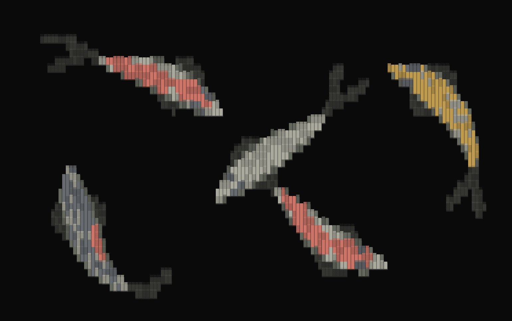

# OpenCode Pond

Animated koi behind your OpenCode terminal. They swim across the home screen and
conversations, passing beneath the logo and message text while the native input
and panels stay readable.



The preview comes from the plugin's actual terminal renderer, with the host UI
hidden to show the fish. It is not an image-generated mockup.

## Features

- Dark and white backgrounds; block-character koi or ASCII symbols.
- Five fish spaced along their travel, with forward motion through turns.
- Head-led body bends, trailing tails, and a seamless one-hour procedural loop.
- Persistent controls for appearance, visibility, and pause/resume.
- No model requests or network activity from the running plugin.

## Install on Windows

Requires OpenCode 2. Tested with **OpenCode 2.1.4 / OpenTUI 0.6.8** on Windows.

```powershell
git clone https://github.com/ASVLCII/opencode-pond.git
cd opencode-pond
powershell -File scripts/install.ps1
```

Restart OpenCode. The default is dark mode with block koi.

The installer copies the runtime into
`%USERPROFILE%\.config\opencode\extensions\opencode-pond`, verifies the copied
files, and adds that directory to `plugins` in `cli.json`. Existing CLI settings
are preserved; backups are kept under the OpenCode configuration's `backups`
directory. You do not need to install development dependencies to use the plugin.

If your configuration is elsewhere, supply its directory:

```powershell
powershell -File scripts/install.ps1 -ConfigDirectory "D:\my-opencode-config"
```

## Controls

Press **Ctrl+P** and search for **Pond background**, or use these commands:

| Command | Effect |
| --- | --- |
| `/white on` | White/light background |
| `/white off` | Dark background |
| `/ascii-koi on` | ASCII-symbol koi |
| `/ascii-koi off` | Block-character koi |
| `/koi on` | Show koi |
| `/koi off` | Hide koi |
| `/pond pause` | Pause swimming |
| `/pond resume` | Resume swimming |

`/white`, `/ascii-koi`, and `/koi` without an argument toggle their setting.
Changing the rendering style does not change visibility or pause state.
The older `/pond dark`, `/pond white`, `/pond blocks`, `/pond ascii`, `/pond on`,
and `/pond off` commands are also supported.

White mode uses OpenCode's own light theme mode. The plugin preserves the native
logo, layout, model controls, and shortcuts. Block koi color the background under
message letters without replacing their glyphs or foreground colors. ASCII mode
leaves a margin around text. Opaque panels and selection keep their backgrounds.

To launch with a still pond:

```powershell
$env:POND_REDUCED_MOTION = '1'
opencode
```

## Updates and removal

The installed plugin lives outside OpenCode's executable/npm installation, so a
normal OpenCode update does not overwrite its files. That protects installation
persistence; future plugin or renderer API changes may still require a fix.

To update the pond, pull this repository and rerun the installer:

```powershell
git pull --ff-only
powershell -File scripts/install.ps1
```

To remove it, delete only the pond's entry from `plugins` in `cli.json` and restart
OpenCode. Backups are kept outside plugin-discovery directories.

## Runtime and compatibility

Animation targets 15 updates per second and hides below 64 columns or 22 rows.
Other plugins' full-screen pages do not animate. Movement is generated in memory;
the one-hour loop is not stored as video or a sequence of frames.

The plugin uses OpenCode's CLI plugin API and OpenTUI post-processing/buffer APIs.
Missing renderer hooks or a drawing error stop the pond with a notification.
This does not guarantee compatibility with every future OpenCode release.
After upgrading OpenCode, check the pond in the actual terminal as well as running
the tests. Non-Windows host integration has not been verified locally.

## Development

Use **Bun 1.3.14+** for native renderer tests. Node 26.4+ satisfies OpenTUI's Node
engine requirement for dependency installation.

```powershell
npm ci
npm run check
bun test
```

Tests cover commands, text/panel preservation, both palettes, renderer cleanup,
small terminals, loop continuity, body follow-through, forward progress, and
distribution over the full hour at multiple window sizes.

Optional renderer captures:

```powershell
bun scripts/capture.ts dark 240 --background-only
bun scripts/capture.ts light 240 --background-only
python -m pip install Pillow
python scripts/render-frames.py
```

Capture artifacts are development output and are ignored by Git. Captures without
`--background-only` use a representative host layout, not a live OpenCode session.

Inspired by [sucodee's ASCII KOI reference](https://x.com/sucodeee/status/2113944922055410008).
